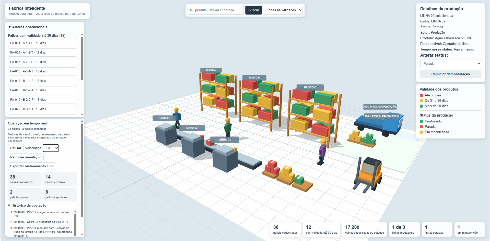

# Fábrica Inteligente 3D

Demonstração interativa de uma fábrica com visualização 3D, produção contínua simulada e rastreamento de pallets. O projeto foi desenvolvido para apresentar, de forma visual, conceitos de operação, estoque, produção e expedição.

### Acesse a demonstração: https://lilianerefatti.github.io/fabrica-inteligente-3d/

## O que você pode explorar
- Navegar pela fábrica em 3D, girando a cena e ajustando o zoom.
- Consultar pallets por identificador, produto, lote ou endereço e filtrar por validade.
- Selecionar pallets e visualizar seus detalhes e etapas de rastreamento.
- Acompanhar três linhas de produção e alterar seus status.
- Observar caixas avançando pela produção, a montagem de pallets e o fluxo de expedição.
- Controlar a simulação, ajustar sua velocidade, pausar e reiniciar a demonstração.
- Consultar o histórico da operação e exportar o rastreamento de pallets em CSV.
- Acompanhar indicadores de produção, pallets prontos, expedições e estoque cadastrado.

## Tecnologias
- HTML, CSS e JavaScript
- Three.js para a cena e os objetos 3D
- GitHub Pages para publicação

## Como executar localmente
1. Baixe ou clone este repositório.
2. Abra a pasta no Visual Studio Code.
3. Inicie index.html com uma extensão de servidor local, como Live Server.
4. Acesse o endereço local exibido pelo servidor.
O projeto importa o Three.js por CDN, portanto é necessário estar conectado à internet ao abrir a demonstração.

## Sobre os dados
Esta é uma demonstração de portfólio. Os dados, volumes, eventos, tempos e movimentações são simulados no navegador. O projeto não está conectado a máquinas, sensores, sistemas de estoque ou serviços de uma fábrica real, e seus indicadores não devem ser usados para decisões operacionais.

## Autoria
Desenvolvido por Liliane Rose Refatti como projeto de portfólio para explorar visualização 3D e conceitos de acompanhamento da produção.
